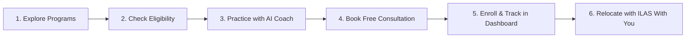

# ILA Global — Platform User Manual & Guide
> **Everything you need to know about ILA Global:** What it offers, how each feature works, and how to get started on your global journey.

---

## 🌟 1. What is ILA Global?

**ILA Global** is an all-in-one international pathway platform designed to help students, job seekers, and working professionals transition smoothly from their home country to top destinations across the world (with a special focus on Germany, Austria, the UK, Canada, and Ireland).

Think of ILA Global as your **personal international career companion**. Instead of having to visit 5 different agencies for language coaching, university admissions, visa paperwork, job placements, and foreign accommodation, **ILA Global integrates everything under one roof**.

### In Short:
* **Learn:** Master foreign languages (German, English, Spanish, French) with certified trainers.
* **Study:** Gain admission into 100% tuition-free public universities or top international colleges.
* **Work:** Secure legal dual-study contracts (Ausbildung), high-paying student jobs (€14–€24/hour), or full-time career roles with visa sponsorships (EU Blue Card).
* **Immigrate:** Navigate complex visa dockets (Germany Opportunity Card / Chancenkarte, student visas, work permits) with step-by-step guidance.
* **Succeed On-Ground:** Never feel stranded with our on-ground concierge (**ILAS With You**) assisting with airport pickup, city registration (Anmeldung), and finding an apartment.

---

## 👥 2. Who is this Website For?

| User Group | How ILA Global Helps You |
| :--- | :--- |
| **High School & College Students** | Find tuition-free university programs abroad, prepare language tests (IELTS / Goethe), and apply with verified documents. |
| **Working Professionals & Techies** | Apply for the German Opportunity Card (*Chancenkarte*) or direct employer-sponsored tech/engineering jobs. |
| **Healthcare Workers & Nurses** | Get certified German B1/B2 training, medical licensing (*Anerkennung*), and zero-recruitment-fee hospital placements. |
| **Career Changers & Vocational Seekers** | Enroll in Germany's famous **Ausbildung (Dual Vocational Training)** where you study and get paid a monthly stipend from Day 1. |
| **Parents & Guardians** | Gain total peace of mind with transparent visa timelines, budget calculators, and dedicated post-arrival safety care. |

---

## 🚀 3. Core Features & What We Offer

Here is a breakdown of the 10 main pillars you will find on this website:

### 1. 🎓 Study Abroad & University Admissions
* **Tuition-Free Public Universities:** We help you access world-class state universities in Germany and Austria where annual tuition fees are **€0**.
* **English-Taught Programs:** Over 1,800+ Bachelor's and Master's degrees taught completely in English.
* **Full Admission Support:** Document notarization, Uni-Assist VPD review, motivation letters (SOP), and direct university liaison.

### 2. 🗣️ Foreign Language Academy
* **German (CEFR Levels A1 to C1):** Tailored batches for Goethe-Zertifikat, Telc, TestDaF, and specialized Medical German (*Fachsprachprüfung*).
* **IELTS Masterclasses:** Guaranteed Band 7.5+ preparation blueprints with Cambridge certified trainers.
* **French (DELF) & Spanish (DELE):** Foundational to advanced conversational and corporate tracks.
* **Flexible Learning:** Live online classes, hybrid schedules, interactive mock exams, and recorded class archives.

### 3. 💼 Work & Study (Dual Track Advantage)
* **Earn While You Learn:** Understand European labor laws that permit international students to work **20 hours per week** (up to 140 full days per year).
* **High Hourly Wages:** Typical student earnings range between **€14.00 and €24.00 per hour**, allowing you to earn **€1,100 to €1,900/month**—completely covering your rent and food.
* **German Onboarding & Ausbildung:** Structured dual vocational training where partner employers pay for your education while paying you a monthly salary.

### 4. 🛂 Visa & Consular Services
* **Germany Chancenkarte (Opportunity Card):** Point-based immigration docket compilation, foreign degree recognition (ZAB/Anabin), and fast-track submission.
* **National Student Visas:** 99.4% approval track for German, UK, and Canadian student permits.
* **Consular Assistance:** Blocked account setup (Sperrkonto), statutory health insurance dockets, and Embassy interview defense training.
* **Live Status Tracker:** Enter your unique application reference number on the website to track your consular file status in real time.

### 5. 🏢 Global Jobs & Careers
* **Direct Hiring with Visa Sponsorship:** Connecting qualified candidates with over 1,200+ European employers.
* **Key Hiring Industries:** Software Engineering, Cloud Architecture, Healthcare & Nursing, Data Science, and Mechanical/Automotive Engineering.
* **EU Blue Card Pathway:** Guidance on qualifying for fast-track permanent residency in Germany and the EU.

### 6. 🤖 Intelli Coach AI (Your 24/7 Virtual Counselor)
* **Instant Guidance:** An intelligent AI assistant on the homepage trained on actual embassy interview questions, university criteria, and visa requirements.
* **Mock Visa Interviews:** Practice real consular defense questions and get instant feedback on your tone, readiness, and confidence score.
* **Resume & SOP Audit:** Get instant tips to optimize your resume and Statement of Purpose for European standards (Europass).

### 7. ⚡ Universal Eligibility Calculator
* **Fast 60-Second Evaluation:** You don't need to wait days for a consultant to reply. Fill in your age, degree, language level, and work experience.
* **Immediate Scorecard:** Instantly see your Chancenkarte immigration points, your eligibility for tuition-free colleges, and estimated monthly student earning potential.

### 8. 🤝 "ILAS With You" (On-Ground Relocation Care)
* Moving to a new country can be scary. Our local teams in Germany (Berlin, Munich, Frankfurt, etc.) and Austria support you from the moment your plane touches down:
  * **Airport Meet & Greet:** Direct private transfer from the airport to your accommodation.
  * **Anmeldung (City Registration):** Assistance with official local government appointments and tax IDs.
  * **Bank Unfreezing:** Helping you activate your blocked account and acquire a local debit card.
  * **SIM Card & 24/7 WhatsApp Hotline:** Emergency assistance in your native language whenever you need help.

### 9. 🏆 Student Rewards & Milestone Grants
* **Learn & Earn:** Every positive step you take earns you reward points—from attending language classes and passing practice exams to submitting university documents.
* **Real Value Redemption:** Exchange points for free official exam vouchers (Goethe / IELTS), flight ticket rebates, visa consultation subsidies, or cash gift vouchers.

### 10. 👤 Student Self-Service Dashboard
* A private account area where registered students can:
  * Check the progress of university applications and visa filings.
  * Access enrolled language course materials, homework, and test schedules.
  * Upload and organize necessary documents (transcripts, passport copies, language certificates).
  * Manage reward points and redeem vouchers.

---

## 🧭 4. Step-by-Step: How to Use this Website

Here is how a visitor typically navigates and benefits from the platform:

### Step 1: Browse & Discover
* Use the top navigation bar to explore your interest:
  * Looking for language training? Head to **[Courses]**.
  * Want a degree in Europe? Click on **[Study Abroad]**.
  * Want to work part-time or join an Ausbildung? Click **[Work & Study]**.
  * Need help with your visa or Chancenkarte? Go to **[Visa Services]**.
  * Looking for career openings? Visit **[Jobs & Careers]**.

### Step 2: Test Your Chances (The Eligibility Checker)
* Click **[Eligibility]** in the top navigation or use the quick checker on the homepage.
* Select your highest qualification, current language ability, and dream country.
* The system evaluates your profile against current statutory laws and immediately presents your pathway score.

### Step 3: Chat with Intelli Coach AI
* On the homepage, scroll to the **Intelli Coach AI** section.
* Ask questions like *"Can I study in Germany without IELTS?"* or *"What are the requirements for the Opportunity Card?"*
* You can also run an interactive mock interview simulator to test your embassy readiness.

### Step 4: Book a Free 1-on-1 Consultation
* Every page has an easy **Enquiry Form** where you can request a callback or video session with a certified counselor.
* Enter your details, choose your preferred destination, and our academic advisors will reach out with a personalized roadmap.

### Step 5: Sign In to Your Student Dashboard
* Click **Sign In** or **Register** at the top right of the website.
* Once logged in, open the **Student Dashboard**:
  * Track active visa & admission dossiers in the **Applications** tab.
  * Access your class timetable and video lessons in the **Courses** tab.
  * Securely upload scanned certificates in the **Documents** section.
  * Monitor your accumulated points in the **Rewards** tab.

### Step 6: Fly and Land Confidently
* Once your visa is granted, book your **ILAS With You** arrival package.
* Meet our local representative at the destination airport, get settled into your student dorm, and start your new life without stress.

---

## 🗺️ 5. Website Map & Quick Directory

| Page Name | Direct URL | What You Will Find Here |
| :--- | :--- | :--- |
| **Home** | `/` | Platform highlights, live metrics, Intelli Coach AI, quick eligibility estimator, and student testimonials. |
| **Courses** | `/courses` | Full catalog of German (A1-C1), IELTS, Spanish, and French language programs with live batch dates and fees. |
| **Study Abroad** | `/study-abroad` | Country guides (Germany, Austria, UK, Canada, Ireland), public vs. private university comparisons, and admission requirements. |
| **Work & Study** | `/work-and-study` | Guides to student employment, hourly wage calculators, German Ausbildung opportunities, and living cost breakdowns. |
| **Visa Services** | `/visa-services` | Chancenkarte (Opportunity Card) instructions, student visa dockets, checklist downloads, and live consular reference status tracker. |
| **Jobs & Careers** | `/jobs-and-careers` | International employment openings, EU Blue Card guidelines, and nurse/engineer credential recognition (*Anerkennung*). |
| **Products** | `/products` | Complete catalog of all ILA Global services, support packages, and digital tools with detailed specs. |
| **Eligibility** | `/check-eligibility` | Comprehensive statutory eligibility engine providing a detailed breakdown of your immigration and academic points. |
| **Rewards** | `/rewards` | Details on the loyalty points system, point earnings rules, and voucher redemption catalog. |
| **Dashboard** | `/dashboard` | Secured personal portal for registered students to track applications, files, and classes. |

---

## ❓ 6. Frequently Asked Questions (FAQ)

### Q1: Is education in Germany really tuition-free?
**Yes.** Public universities in Germany are funded by the federal government. Both domestic and international students pay **€0 tuition fees** for most Bachelor and Master programs. Students only pay a minor semester administrative fee (typically €150–€350 per semester), which usually includes a free regional public transit pass.

### Q2: What is the German Opportunity Card (*Chancenkarte*)?
The *Chancenkarte* is Germany's point-based immigration visa introduced under the Skilled Immigration Act. It allows qualified professionals to enter Germany for up to one year to find a qualified job, while permitting legal part-time work of up to 20 hours per week during the search.

### Q3: Do I need to know German before moving abroad?
* For **English-taught university degrees**: German is usually not mandatory for admission (you need IELTS/TOEFL), but knowing basic German (A1/A2) is strongly recommended for daily life and part-time student jobs.
* For **Healthcare (Nursing/Doctors)** and **Ausbildung**: German proficiency (B1/B2) is legally required. ILA's Language Academy prepares you specifically for these official certifications.

### Q4: How does the Intelli Coach AI differ from a real counselor?
Intelli Coach AI gives you instant, 24/7 answers, evaluates your documents on the fly, and lets you practice consular interview questions with zero waiting time. When you are ready for formal filing, our human certified counselors take over to handle your legal paperwork and university applications.

### Q5: Is my personal information and document upload safe?
**Yes.** All uploaded documents and student records are encrypted and protected under strict data privacy regulations. Only authorized compliance officers and counselors assigned to your case have access to your documents.

---

## 📞 7. Need Help or Want to Get Started?

* **Explore the Website:** Start by browsing the programs above or test your chances on the **Eligibility Calculator**.
* **Book a Free Consultation:** Scroll to the bottom of any page and submit the quick enquiry form.
* **Student Support:** Log in to your account or reach out to our advisory team directly via the contact options on the website.

---
*Manual compiled for ILA Global Platform users, prospective students, and international career aspirants.*
